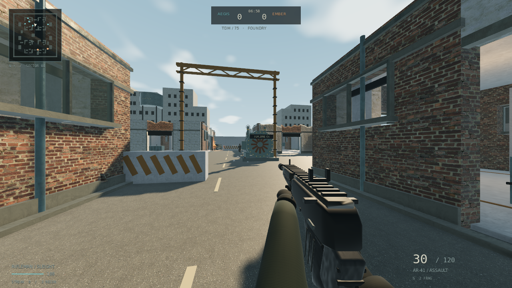
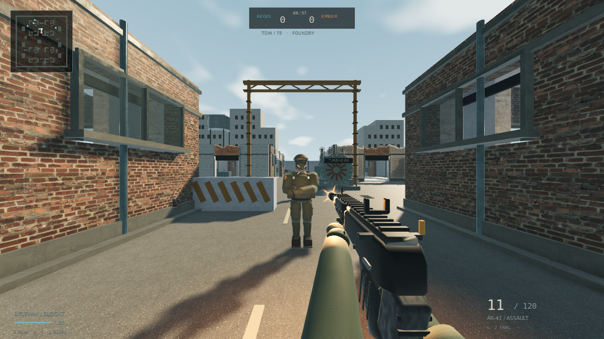
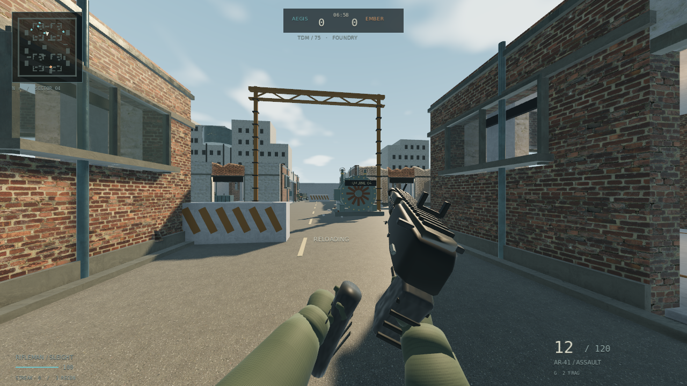

# ASHLINE 0.4 — PC alpha

Рабочая ранняя альфа. Ориентир COD4 по качеству изображения пока не достигнут; персонажи, оружейные поверхности и интерьеры требуют дальнейшей переработки.

Готовые архивы: открыть ZIP → **Download raw file**. Репозиторий приватный: нужен вход в GitHub с доступом.

- [Windows x64](ASHLINE-0.4-Windows-x64.zip)
- [Linux x64](ASHLINE-0.4-Linux-x64.zip)
- [Исходники](ASHLINE-0.4-Source.zip)
- [Скриншоты и проверка](ASHLINE-0.4-Screenshots.zip)
- [SHA-256](ASHLINE-0.4-SHA256.json)

Распаковать → ASHLINE.exe или ASHLINE.x86_64 → PLAY → выбрать класс. TDM 6v6 с ботами, 75 убийств / 7 минут. LAN и dedicated включены. Для видеокарты без Vulkan использовать Launch-OpenGL.

В этой версии: новые формы оружия/рукавов/перчаток, скелетный контакт кисти при reload, настоящие оконные проёмы, CC0 PBR ambientCG и восемь записей выстрелов Free Firearm Sound Library, исправление смены оружия и показа коротких эффектов, удаление кубических частиц попадания в тело перед камерой, циклический порядок обработки ботов.

Проверены Linux Vulkan/OpenGL, 49 основных + 14 регрессий + 10 арт-проверок, полный игровой цикл, bot-vs-bot матчи, сервер с 12 отдельными клиентами. Рендер в среде программный llvmpipe, звук Dummy. Windows экспортирован, но не запускался; игровой GPU и реальное прослушивание не проверены.

Снимки ниже получены из экспортированного Linux-билда и воспроизводимого теста стрельбы. Нет ретуши или концепт-арта. В съёмке игрок защищён; постановочный тест останавливает бойцов.

Исходники: [main](https://github.com/blacksteelman/Ashline/tree/main), tag v0.4.0-alpha. В исходниках — LICENSES.md, assets/thirdparty/SOURCES.json и SESSION_HANDOFF.md.

Все четыре ZIP обратно скачаны из GitHub; SHA-256 совпали, ZIP прошли проверку целостности. [Отчёт скачивания](GITHUB-DOWNLOAD-VERIFICATION.json).
